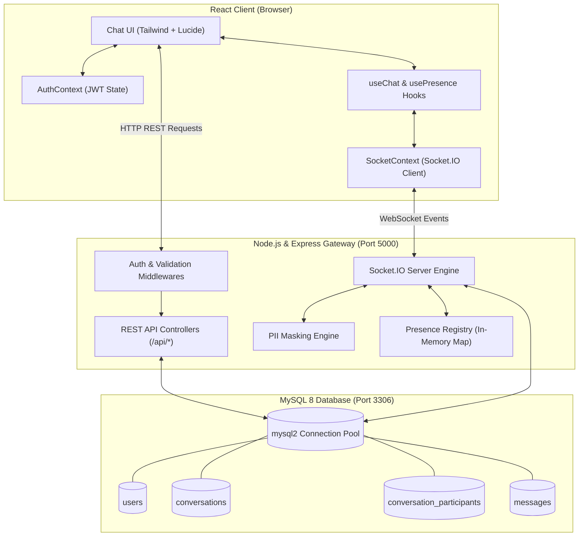
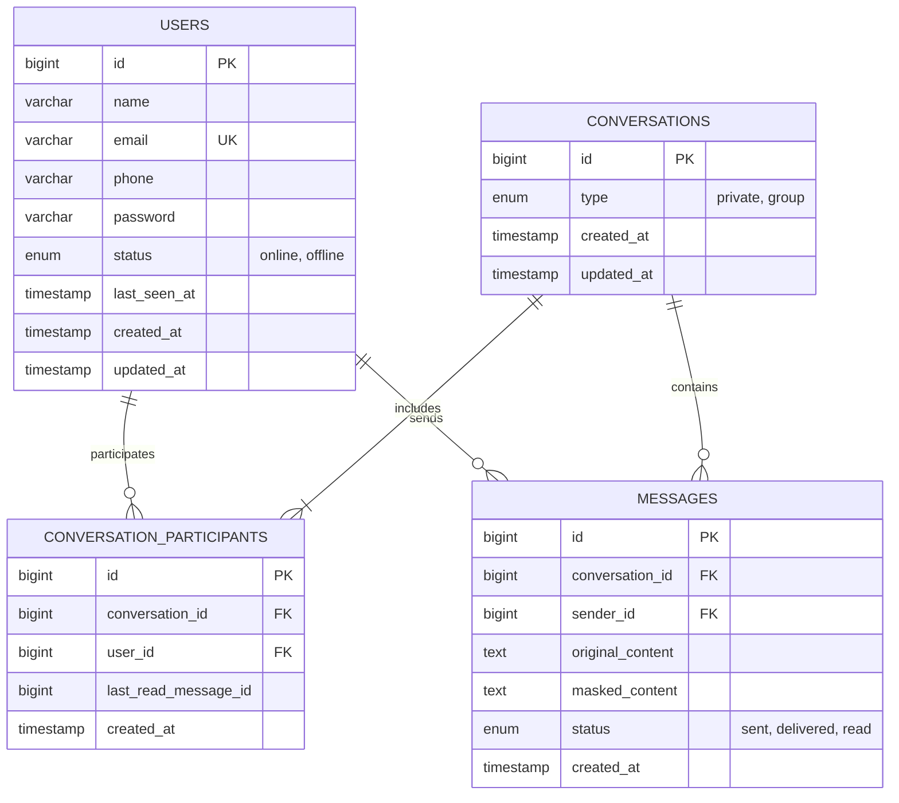

# Real-Time Private Chat System — Comprehensive Project Documentation

A high-performance, secure, full-stack 1-on-1 real-time messaging application built with **React (Vite)**, **Node.js (Express)**, **Socket.IO**, and **MySQL 8** (with connection pooling via `mysql2/promise`).

---

## Table of Contents

1. [Executive Summary & Tech Stack](#1-executive-summary--tech-stack)
2. [High-Level System Architecture](#2-high-level-system-architecture)
3. [Database Architecture & Schema](#3-database-architecture--schema)
4. [WebSocket Protocol & Real-Time Specifications](#4-websocket-protocol--real-time-specifications)
5. [REST API Specification](#5-rest-api-specification)
6. [Sensitive PII Masking Engine](#6-sensitive-pii-masking-engine)
7. [Frontend Architecture & Component Tree](#7-frontend-architecture--component-tree)
8. [Security & Optimization Considerations](#8-security--optimization-considerations)
9. [Installation & Setup Guide](#9-installation--setup-guide)
10. [Pre-Seeded Demo Accounts & Testing](#10-pre-seeded-demo-accounts--testing)
11. [Troubleshooting & FAQ](#11-troubleshooting--faq)

---

## 1. Executive Summary & Tech Stack

The system delivers instant 1-on-1 private messaging without HTTP polling. It features real-time presence detection (online/offline/last-seen), dynamic typing indicators, read receipts, audio chimes, optimistic client updates, and an automated PII (Personally Identifiable Information) masking engine that sanitizes sensitive phone numbers and emails on the fly.

### Technology Stack

| Layer | Technologies Used | Key Libraries & Tools |
| :--- | :--- | :--- |
| **Frontend** | React 18 (Vite SPA) | Tailwind CSS, Lucide React, Socket.IO Client, Axios |
| **Backend** | Node.js (v18+) & Express | Socket.IO Server, JSON Web Tokens (`jsonwebtoken`), `bcryptjs`, `cors`, `dotenv` |
| **Database** | MySQL 8.x / MariaDB (XAMPP) | `mysql2/promise` (Connection Pooling & Prepared Statements) |
| **Audio** | HTML5 Web Audio API | Synthesized non-blocking incoming notification chime |

---

## 2. High-Level System Architecture



### Communication Flow: Zero-Polling Strategy

1. **Initial Load:** React authenticates via REST (`/api/auth/login`) and saves the JWT token in `localStorage`.
2. **WebSocket Handshake:** React opens a persistent WebSocket connection through `SocketContext`, authenticating using the JWT in `auth: { token }`.
3. **Room Subscription:** Node.js places the authenticated socket into an isolated private room named `user_${userId}`.
4. **Instant Push:** When Alice messages Bob:
   - Alice emits `message:send` to Node.js.
   - Node.js masks any phone numbers/emails and writes the record to MySQL.
   - Node.js immediately pushes `message:receive` directly to Bob's room `user_${bobId}`.
   - Bob's browser receives the message without sending any polling requests.

---

## 3. Database Architecture & Schema

### Entity-Relationship Diagram



### Table Definitions & Indexing

#### 1. `users`
* Stores user accounts, credentials, and real-time presence indicators.
* **Indexes:** `idx_users_email` (UNIQUE), `idx_users_status`.

#### 2. `conversations`
* Groups participants together. Defaults to `type = 'private'` for 1-on-1 dialogues.
* **Indexes:** `idx_conversations_updated_at` (DESC) for sorting recent chats in the sidebar.

#### 3. `conversation_participants`
* Pivot table mapping users to conversations.
* **Constraints:** Composite unique key `uq_convo_user (conversation_id, user_id)`.
* **Foreign Keys:** Cascading deletes on `conversation_id` and `user_id`.

#### 4. `messages`
* Stores chat history with both original and masked text.
* **Indexes:** Composite index `idx_convo_history (conversation_id, created_at DESC)` ensures efficient cursor-based pagination when loading conversation history.

---

## 4. WebSocket Protocol & Real-Time Specifications

### Authentication Handshake

The Socket.IO connection is authenticated before any events are processed:

* **Client Request:** Passes `{ auth: { token: '<JWT_TOKEN>' } }`.
* **Server Interceptor:** `socketAuth.js` validates the token using `jsonwebtoken`. If valid, it assigns the authenticated user model to `socket.user`. If invalid or absent, the handshake fails with `Authentication error`.

### Event Catalog

| Event Name | Emitter $\rightarrow$ Receiver | Payload | Purpose |
| :--- | :--- | :--- | :--- |
| `message:send` | Client $\rightarrow$ Server | `{ recipientId, content, tempId }` | Emitted when a user sends a message. |
| `message:receive` | Server $\rightarrow$ Recipient | `{ id, tempId, conversationId, senderId, senderName, senderAvatar, recipientId, content, status, createdAt }` | Delivers the incoming message to recipient's private room `user_${recipientId}`. |
| `message:sent` | Server $\rightarrow$ Sender | `{ tempId, message, conversationId }` | Server acknowledgment returning the persisted database record and ID. |
| `message:typing` | Client $\rightarrow$ Server | `{ recipientId, isTyping }` | Transmits live typing state (true/false). |
| `user:typing` | Server $\rightarrow$ Recipient | `{ senderId, isTyping }` | Notifies recipient to display the 3-dots typing bubble. |
| `message:seen` | Client $\rightarrow$ Server | `{ conversationId, messageIds, senderId }` | Dispatched when recipient views unread messages. |
| `message:status_update` | Server $\rightarrow$ Sender | `{ conversationId, messageIds, status: 'read' }` | Informs sender to display double blue checkmarks. |
| `user:status_changed` | Server $\rightarrow$ All Clients | `{ userId, status: 'online' \| 'offline', lastSeen }` | Broadcasts user presence changes. |

### Presence Lifecycle & Multi-Tab Synchronization

Presence tracking is managed in-memory via `PresenceService`:
* Tracks a set of active socket IDs for each `userId`: `Map<userId, Set<socketId>>`.
* **Online Trigger:** When a user opens their first tab (`Set.size === 1`), status is updated to `online` in MySQL and broadcasted.
* **Offline Trigger:** When a user closes a tab, that socket ID is deleted. If `Set.size === 0`, the user is officially marked `offline` in MySQL, `last_seen_at` is set to the current timestamp, and `user:status_changed` is broadcasted.
* **Resilience:** Opening multiple browser tabs under the same account maintains active presence without sending duplicate offline/online flicker events.

---

## 5. REST API Specification

Base URL: `http://localhost:5000/api`

All protected endpoints require the HTTP Authorization header:
```http
Authorization: Bearer <JWT_TOKEN>
```

### Standard JSON Response Envelope

* **Success:**
  ```json
  {
    "success": true,
    "data": { ... }
  }
  ```
* **Error:**
  ```json
  {
    "success": false,
    "error": "Error message description"
  }
  ```

---

### Endpoints

#### Authentication (`/api/auth`)

##### 1. Register User
* **Method:** `POST /api/auth/register`
* **Body:**
  ```json
  {
    "name": "John Doe",
    "email": "john@example.com",
    "password": "password123",
    "phone": "+1 555-123-4567"
  }
  ```
* **Response (201 Created):**
  ```json
  {
    "success": true,
    "data": {
      "user": { "id": 1, "name": "John Doe", "email": "john@example.com", "phone": "55******67" },
      "token": "eyJhbGciOiJIUzI1NiIsInR5cCI6..."
    }
  }
  ```

##### 2. Login User
* **Method:** `POST /api/auth/login`
* **Body:**
  ```json
  {
    "email": "john@example.com",
    "password": "password123"
  }
  ```
* **Response (200 OK):** Returns authenticated user object and JWT token.

##### 3. Get Current User Profile
* **Method:** `GET /api/auth/me`
* **Headers:** `Authorization: Bearer <token>`
* **Response (200 OK):** Returns current user details.

---

#### Users & Contacts (`/api/users`)

##### 1. Get Contacts List
* **Method:** `GET /api/users/contacts`
* **Description:** Retrieves all users with whom the authenticated user has chatted or can chat, with last message preview, unread message count, and online/offline status.

##### 2. Search Users
* **Method:** `GET /api/users/search?q=alice`
* **Description:** Case-insensitive search by user name or email.

##### 3. Get User Profile
* **Method:** `GET /api/users/:id`
* **Description:** Returns profile metadata for a specific user ID.

---

#### Conversations & Messages (`/api/conversations`)

##### 1. Get or Create 1-on-1 Conversation
* **Method:** `GET /api/conversations/user/:userId`
* **Description:** Finds the existing conversation between current user and target user, or creates one if it does not exist yet.

##### 2. Get Paginated Messages
* **Method:** `GET /api/conversations/:conversationId/messages?beforeId=150&limit=30`
* **Description:** Cursor-based pagination. Fetches up to `limit` messages created before `beforeId`.

##### 3. Mark Messages as Read
* **Method:** `POST /api/conversations/:conversationId/read`
* **Body:** `{ "senderId": 2 }`
* **Description:** Updates all unread messages from `senderId` in this conversation to status `read`.

---

## 6. Sensitive PII Masking Engine

To comply with data privacy policies and prevent data leakage, `masking.service.js` automatically sanitizes phone numbers and email addresses before storing in MySQL and broadcasting via WebSockets.

### Masking Rules

1. **Email Addresses:**
   * Keeps the first character of the username and the last character (if length $\ge 3$).
   * Masks intermediate characters with `*`.
   * Preserves `@` and the full domain name.
   * *Examples:*
     * `john.doe@example.com` $\rightarrow$ `j******e@example.com`
     * `me@domain.com` $\rightarrow$ `**@domain.com`
2. **Phone Numbers:**
   * Recognizes international prefixes (`+`), country codes, parentheses, dashes, and spaces.
   * Keeps the first 2 digits and last 2 digits visible; masks all intermediate digits with `*`.
   * *Examples:*
     * `9876543210` $\rightarrow$ `98******10`
     * `+91 98765 43210` $\rightarrow$ `+91 98******10`
     * `(555) 123-4567` $\rightarrow$ `55******67`

---

## 7. Frontend Architecture & Component Tree

The React client is architected around reusable components, custom context providers, and hooks:

```text
client/src/
├── context/
│   ├── AuthContext.jsx       # Holds user object, token, login(), logout()
│   └── SocketContext.jsx     # Manages single Socket.IO instance and connection status
├── hooks/
│   ├── useChat.js            # Handles sending messages, optimistic UI, ACK replacement, typing debounce
│   └── usePresence.js        # Maintains Map<userId, { status, lastSeen }> from WebSocket broadcasts
├── components/
│   ├── auth/
│   │   ├── LoginForm.jsx     # Email & password form + 1-click quick-demo login buttons
│   │   └── RegisterForm.jsx  # New user registration
│   ├── chat/
│   │   ├── ChatLayout.jsx    # Split-pane layout (Sidebar + Chat Area)
│   │   ├── Sidebar.jsx       # Header, SearchBar, and UserList
│   │   ├── UserList.jsx      # Scrollable list of contacts with badges
│   │   ├── UserItem.jsx      # Single contact item with status dot, last message, unread count
│   │   ├── ChatWindow.jsx    # Active conversation container
│   │   ├── ChatHeader.jsx    # Contact avatar, name, online / last seen status, typing indicator
│   │   ├── MessageList.jsx   # Message scroll container with date dividers
│   │   ├── MessageBubble.jsx # Message item, bubble colors, timestamp, status checkmarks
│   │   ├── MessageInput.jsx  # Input field, typing emitter, send button
│   │   └── TypingIndicator.jsx # Animated 3-dot typing visualizer
│   └── common/
│       ├── Avatar.jsx        # Rounded avatar with online status indicator dot
│       └── Badge.jsx         # Counter pill for unread messages
└── utils/
    └── sound.js              # Web Audio API notification sound generator
```

### Optimistic UI Updates

When a user submits a message:
1. `useChat.js` instantly creates a message object with a temporary ID (`temp_1729...`) and status `'sending'`, immediately appending it to the UI.
2. The `message:send` socket event is dispatched.
3. Once the server confirms insertion and emits `message:sent`, the client replaces the `tempId` item with the confirmed database record and sets the status to `'sent'`.

---

## 8. Security & Optimization Considerations

1. **SQL Injection Prevention:** Every database query in `server/src/models/` uses parameterized inputs `[?]` through `mysql2/promise`.
2. **WebSocket Handshake Validation:** Socket connections without valid JWT authorization headers or tokens are rejected before socket allocation.
3. **In-Memory Rate Limiting:** A sliding window tracker (`messageRateMap`) blocks spam by limiting socket messages to **5 messages per second per user**.
4. **Data Isolation (PII):** Sanitization happens server-side before persisting or forwarding. Unmasked PII is never pushed to other connected clients.
5. **Reverse Cursor Pagination:** Instead of heavy `OFFSET` queries, messages are fetched using `WHERE id < :beforeId ORDER BY id DESC LIMIT 30`. This guarantees constant query times regardless of chat history depth.
6. **Graceful Disconnection Handling:** Clean removal of socket references ensures accurate online/offline state across tab closures, refreshes, and network drops.

---

## 9. Installation & Setup Guide

### Prerequisites
* **Node.js:** v18.0.0 or higher
* **XAMPP / MySQL:** MySQL 8.x or MariaDB running on port `3306`

### Step 1: Clone and Configure Environment

1. Ensure MySQL is running in your XAMPP Control Panel.
2. Verify `.env` configurations:
   * **`server/.env`:**
     ```env
     PORT=5000
     NODE_ENV=development
     DB_HOST=127.0.0.1
     DB_PORT=3306
     DB_USER=root
     DB_PASSWORD=
     DB_NAME=db_chatsystem
     DB_CONNECTION_LIMIT=10
     JWT_SECRET=super_secret_jwt_key_chatapp_2026_dev
     JWT_EXPIRES_IN=7d
     CLIENT_URL=http://localhost:5173
     ```
   * **`client/.env`:**
     ```env
     VITE_API_URL=http://localhost:5000/api
     VITE_SOCKET_URL=http://localhost:5000
     ```

### Step 2: Database Migration & Seeding

From the project root:
```bash
npm run migrate
npm run seed
```
This automatically creates the `db_chatsystem` database, builds all tables, sets foreign keys, and seeds 4 demo users with mock message history.

### Step 3: Run the Application

* **Option A: Run concurrently from root:**
  * Terminal 1: `npm run server`
  * Terminal 2: `npm run client`
* **Option B: Run from individual folders:**
  * Backend:
    ```bash
    cd server
    npm start
    ```
  * Frontend:
    ```bash
    cd client
    npm run dev
    ```

Client application will be accessible at: `http://localhost:5173`  
Backend API will be accessible at: `http://localhost:5000`

---

## 10. Pre-Seeded Demo Accounts & Testing

For testing 1-on-1 real-time messaging, you can open two different browsers (or one normal and one incognito window) and log into two different accounts:

| User Name | Email | Password | Pre-seeded Contact |
| :--- | :--- | :--- | :--- |
| **Alice Johnson** | `alice@example.com` | `password123` | Bob Smith, Charlie Brown |
| **Bob Smith** | `bob.smith@example.com` | `password123` | Alice Johnson, Diana Prince |
| **Charlie Brown** | `charlie.brown@example.com` | `password123` | Alice Johnson |
| **Diana Prince** | `diana@example.com` | `password123` | Bob Smith |

> **Tip:** The login screen provides 1-click quick-fill buttons for each demo account for rapid testing.

### Running Automated Integration Tests

To run the end-to-end backend integration tests (verifying JWT authentication, database connections, PII masking, and WebSocket message exchange):

```bash
cd server
npm test
```

---

## 11. Troubleshooting & FAQ

### 1. `ECONNREFUSED 127.0.0.1:3306`
* **Cause:** MySQL server is not running.
* **Fix:** Open XAMPP Control Panel and start the **MySQL** module. Verify port is `3306`.

### 2. `CORS policy: No 'Access-Control-Allow-Origin' header`
* **Cause:** Frontend origin mismatch with backend configuration.
* **Fix:** Verify `CLIENT_URL=http://localhost:5173` in `server/.env` and ensure Vite is running on port 5173.

### 3. `WebSocket connection failed: Authentication error`
* **Cause:** Expired or missing JWT token.
* **Fix:** Log out of the client app and log back in to generate a fresh JWT token in `localStorage`.

### 4. Audio Chime Not Playing
* **Cause:** Modern browsers block autoplay audio until the user interacts with the page (clicks or types).
* **Fix:** Once the user clicks anywhere in the chat window, Web Audio API is initialized and sounds will play for incoming messages.
